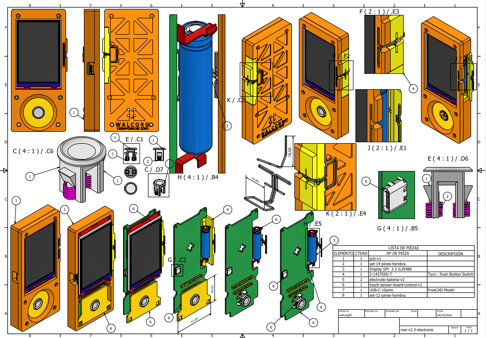
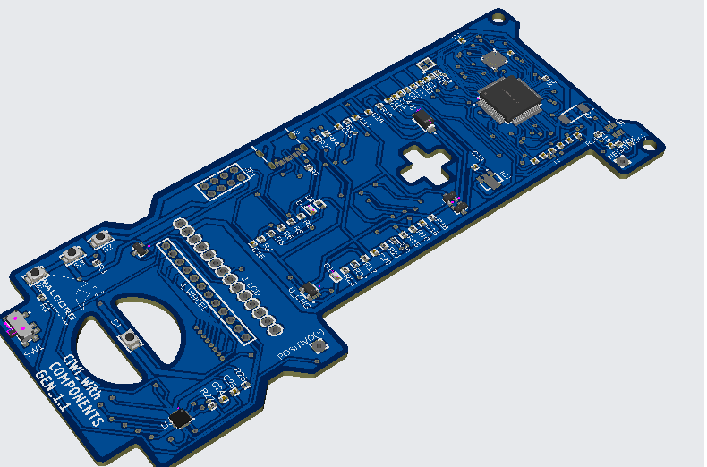
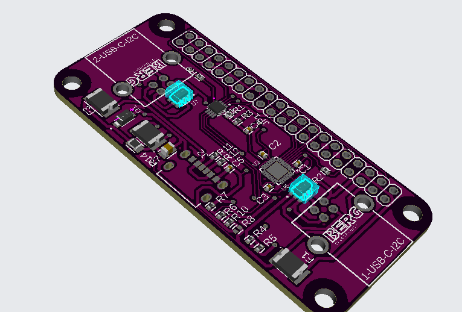

# Anchor Protocol

**Hardware-anchored issuance for open photobioreactor networks.**

The Anchor Protocol ties every Codosin (CO2in) token on Polygon to two pieces of open,
auditable hardware built around the [TROPIC01](https://tropicsquare.com/tropic01) secure element:

- the **shield** on a WALCORG photobioreactor node, which signs a capture receipt for each
  measurement window, and
- the **CiWi** cold wallet, which verifies that receipt, shows it to its owner and co-signs
  the claim only after a physical button press.

A verifier contract checks both P-256 signatures with Polygon's native `P256VERIFY`
precompile, enforces physical capture limits and a dispute window, and only then mints.

> **Status: draft v0.2, open for review.** Field names, limits and encodings may change.
> Items marked **[TBC]** in the spec depend on TROPIC01 behaviour still to be confirmed.

## Custom open hardware

The protocol is built for two devices designed by WALCORG. Both are open source and
under active development.



*CiWi v2.3 — assembly drawing of the cold wallet: 3.5" SPI display, touch click-wheel,
physical confirmation button, battery and USB-C.*

| CiWi main board | Node shield for Raspberry Pi Zero |
| --- | --- |
|  |  |
| CiWi Gen 1.1 — STM32-based main board with display header and click-wheel cut-out. | Node shield — sits on the Raspberry Pi Zero running Clorela-Os and reads the node sensors. |

## What it guarantees, and what it does not

| Guaranteed by hardware and contract | Not guaranteed (handled by caps, reference cultures and review) |
| --- | --- |
| A claim comes from a registered shield and a registered CiWi bound to it | That a culture is alive or a sensor reading is true |
| Receipts cannot be replayed, moved to another chain or redirected to another owner | Permanent sequestration of the captured CO2 |
| Issuance per shield never exceeds its on-chain physical cap | |

## Repository layout

| Path | Contents |
| --- | --- |
| [`SPEC.md`](SPEC.md) | Full specification: actors, keys, message formats, flows, encoding, contract rules, security, open questions, NFT profile, implementation checklist, user journey |
| [`proto/anchor.proto`](proto/anchor.proto) | USB messages between host and CiWi (Trezor wire protocol, proto2) |
| [`eip712/types.json`](eip712/types.json) | EIP-712 domain and types, machine-readable |
| [`reference/nft-genesis-v7`](reference/nft-genesis-v7) | Reference implementation of the NFT profile: Solidity contract and 15 Hardhat tests |
| [`docs/images`](docs/images) | Hardware renders of the CiWi and the node shield |
| [`LICENSE-SPEC`](LICENSE-SPEC) | CC BY 4.0, for the specification text |
| [`LICENSE`](LICENSE) | MIT, for code in this repository |

## Run the reference tests

```bash
cd reference/nft-genesis-v7
npm install
npx hardhat test
```

The tests simulate both TROPIC01 chips with P-256 keys and check, among others, that a
record signed by another key, a record altered after signing, a missing CiWi signature, a
high-s signature, a replay and an out-of-order token are all rejected.

## Roadmap

- **v0.3** — shared test vectors for the core flows (Python, C, Solidity, TypeScript), answers
  to the open questions in SPEC section 9, verifier contract for Codosin on Amoy.
- **Later** — secp256k1 support once TROPIC01 firmware adds it (curve id 2 is already reserved).

## Feedback

Issues and pull requests are welcome, especially on the TROPIC01 questions in SPEC section 9.

Maintained by WALCORG · [walcorg.com](https://walcorg.com)
