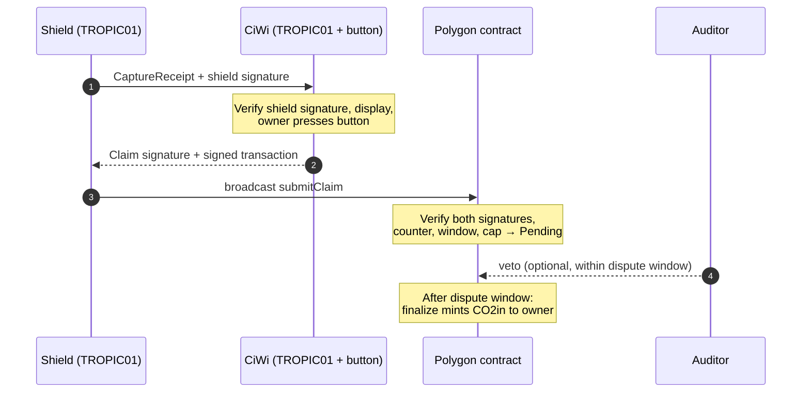

# Anchor Protocol v0.2 — Draft Specification

Author: Walter (WALCORG) · Last updated: 2026-10-19 · Status: draft for review

## 1. Overview

**Abstract.** The Anchor Protocol binds token issuance to two pieces of open hardware. A *shield* on a photobioreactor node signs a capture receipt with a key held in its TROPIC01. A registered *CiWi* cold wallet, also built around a TROPIC01, verifies that receipt, shows it to its owner and co-signs a claim after a physical button press. A verifier contract on Polygon checks both signatures and its own physical limits before Codosin (CO2in) is minted.

**Status.** Draft v0.2 for review. v0.2 adds the NFT profile (section 11), used by the Bioentropy Genesis contract v7, the implementation checklist (section 12) and the user journey (section 13). Field names, limits and encodings may change. Items marked **[TBC]** depend on TROPIC01 behaviour still to be confirmed (see section 9).

**Actors**

| Actor | Hardware / software | Role |
| --- | --- | --- |
| Shield | Raspberry Pi Zero W + WALCORG shield with TROPIC01, running Clorela-Os; serves one or more nodes | Measures, builds and signs capture receipts |
| CiWi | STM32F405 + TROPIC01, display, click-wheel, physical button | Verifies receipts, shows them, co-signs claims, sends the owner's transaction |
| Registry & Verifier | Solidity contract on Polygon PoS; sole holder of the CO2in minter role | Stores keys and bindings, enforces rules, mints after dispute |
| Platform | walcorg.com (web + server) | Registers CiWi devices by challenge-response; never holds user funds or mint rights |
| Auditor | Off-chain service with reference cultures | Reviews claims during the dispute window; may veto |
| Owner | The node-runner | Holds the CiWi and approves every bind and claim |

**Goals**

- A claim can only come from a registered shield **and** a registered CiWi bound to it.
- Receipts cannot be replayed, reused across chains or contracts, or redirected to another owner.
- Issuance per shield is bounded by physical limits enforced on-chain.
- Every component is open source and independently implementable from this document.
- Curve agility: the format supports P-256 today and secp256k1 when TROPIC01 adds it.

**Non-goals**

- Proving that a culture is alive or that a sensor reading is true. Signatures prove *where* a receipt came from, not *whether* it is accurate. Physical caps, reference cultures and the dispute window address accuracy.
- Permanent sequestration of the captured CO2, which depends on how biomass is handled.
- Custody of user funds by WALCORG.

## 2. Identities, keys and registration

**Device keys.** Each shield and each CiWi generates one *anchor key* inside its TROPIC01 with `ECC_Key_Generate` in a dedicated slot. The private key never leaves the chip. The slot's User Access Policy allows signing only through the pairing key held by the device's own firmware **[TBC]**.

**Curve agility.** Every key and signature carries a `curve` field:

| Value | Curve | On-chain verification |
| --- | --- | --- |
| 1 | P-256 (secp256r1) | `P256VERIFY` precompile at 0x100 (RIP-7212, active on Polygon PoS) |
| 2 | secp256k1 | `ecrecover`; reserved until TROPIC01 firmware supports it |

**Identifiers.**

- `shieldId = keccak256(curve ‖ pubX ‖ pubY)`
- `ciwiId = keccak256(curve ‖ pubX ‖ pubY)`

A new key always means a new identifier. Identifiers are never reused after revocation.

**Shield registration.** During assembly, WALCORG's provisioning bench reads the chip's factory X.509 certificate, validates it against the Tropic Square root, opens the authenticated secure session, generates the anchor key and records `maxNodes` (the number of nodes this shield may serve). The registrar (multisig) then calls `registerShield`.

**CiWi registration (self-service).** The owner registers a CiWi on walcorg.com (flow R, section 4). The platform verifies the factory certificate and a fresh challenge signature, then issues a short-lived `RegistryApproval`. The owner submits that approval on-chain from the CiWi's own address. The platform never registers a device on its own.

**Binding.** A shield is bound to exactly one registered CiWi and its owner address at a time (flow B). A CiWi may be bound to several shields.

**Revocation.**

- The owner may unbind a shield or retire a CiWi at any time.
- The registrar may revoke a key for compromise or confirmed fraud. Revoked keys are never reactivated.

## 3. Message formats

All signed messages are EIP-712 typed structures (section 5), so the shield, the CiWi and the contract compute the same 32-byte digest. Machine-readable types: [`eip712/types.json`](eip712/types.json).

**CaptureReceipt** — signed by the shield, one per claim window.

| Field | Type | Meaning |
| --- | --- | --- |
| `version` | uint8 | Protocol version (2 for v0.2) |
| `curve` | uint8 | Curve of the shield key |
| `shieldId` | bytes32 | Shield identifier |
| `owner` | address | Bound owner; the receipt is unusable by anyone else |
| `counter` | uint64 | Strictly increasing per shield; enforced on-chain |
| `windowStart`, `windowEnd` | uint64 | Unix seconds; windows never overlap |
| `nodeCount` | uint16 | Nodes measured in this window, ≤ `maxNodes` |
| `co2Mg` | uint64 | CO2 claimed for the window, in milligrams |
| `dataRoot` | bytes32 | Merkle root of raw samples, stored off-chain |
| `challenge` | bytes32 | External challenge used for the optical test |
| `responseHash` | bytes32 | Hash of the optical response transcript |
| `nonce` | bytes16 | From the TROPIC01 TRNG; uniqueness only |
| `fwHash` | bytes32 | Hash of the shield measurement firmware |

**Claim** — signed by the CiWi anchor key after the button press.

| Field | Type | Meaning |
| --- | --- | --- |
| `receiptHash` | bytes32 | EIP-712 struct hash of the CaptureReceipt |
| `ciwiId` | bytes32 | CiWi identifier |
| `owner` | address | Must equal `receipt.owner` |
| `ciwiCounter` | uint64 | Strictly increasing per CiWi |

**Bind** — signed by the shield, then approved on the CiWi.

| Field | Type | Meaning |
| --- | --- | --- |
| `shieldId` | bytes32 | Shield to bind |
| `ciwiId` | bytes32 | Registered CiWi |
| `owner` | address | Owner address |
| `nonce` | uint256 | Single use, issued by the contract per shield |

**RegistryApproval** — signed by the platform registrar after a successful web registration.

| Field | Type | Meaning |
| --- | --- | --- |
| `ciwiId` | bytes32 | Identifier being registered |
| `curve`, `pubX`, `pubY` | uint8, bytes32, bytes32 | Anchor public key |
| `chipSerialHash` | bytes32 | Hash of the chip serial from the factory certificate; one registration per chip |
| `owner` | address | Address that must submit the approval |
| `expiry` | uint64 | Approval deadline |

## 4. Flows

**Flow R — Register a CiWi (once per device)**

1. The owner signs in on walcorg.com and connects the CiWi over WebUSB.
2. The platform sends `AnchorRegisterRequest` with a random 32-byte challenge, the account ID and the owner address.
3. The CiWi shows the request; the owner presses the button.
4. The CiWi returns its factory X.509 certificate, its anchor public key and a signature over the challenge.
5. The platform verifies the certificate chain to the Tropic Square root, the signature, and that the chip serial has never been registered. It issues a `RegistryApproval`.
6. The owner submits the approval on-chain from the CiWi address (`registerCiWi`).

**Flow B — Bind a shield to a CiWi**

1. The CiWi connects to the shield over USB (Raspberry Pi Zero W OTG port).
2. The shield reads the next bind nonce from the contract and signs a `Bind`.
3. The CiWi verifies the shield signature, shows "Bind shield … to this wallet?" and waits for the button.
4. The CiWi signs the `Bind` with its anchor key and signs the owner transaction `bind(...)`, which carries both signatures.

**Flow C — Claim (every claim window)**

1. The shield builds a `CaptureReceipt` for the closed window and has its TROPIC01 sign the digest.
2. The CiWi verifies the shield signature against the bound shield key and displays shield, window, CO2 and estimated tokens.
3. On the button press, the CiWi signs a `Claim` with its anchor key and signs the owner transaction `submitClaim(receipt, shieldSig, claim, ciwiSig)`.
4. The shield, or any connected host, broadcasts the transaction. The contract verifies and records a pending claim.
5. During the dispute window the auditor may veto. Afterwards anyone may call `finalize` to mint.



A tampered host can only delay a claim: it cannot change what the CiWi displays, because the CiWi checks the shield signature itself.

## 5. Encoding

**EIP-712 domain**

```text
name:              "WALCORG Anchor"
version:           "0.2"
chainId:           137 (Polygon PoS) / 80002 (Amoy testnet)
verifyingContract: <AnchorVerifier address>
```

**EIP-712 types**

```text
CaptureReceipt(uint8 version,uint8 curve,bytes32 shieldId,address owner,uint64 counter,uint64 windowStart,uint64 windowEnd,uint16 nodeCount,uint64 co2Mg,bytes32 dataRoot,bytes32 challenge,bytes32 responseHash,bytes16 nonce,bytes32 fwHash)
Claim(bytes32 receiptHash,bytes32 ciwiId,address owner,uint64 ciwiCounter)
Bind(bytes32 shieldId,bytes32 ciwiId,address owner,uint256 nonce)
RegistryApproval(bytes32 ciwiId,uint8 curve,bytes32 pubX,bytes32 pubY,bytes32 chipSerialHash,address owner,uint64 expiry)
```

Digest = `keccak256(0x1901 ‖ domainSeparator ‖ structHash)`. The host passes this 32-byte digest to TROPIC01 `ECDSA_Sign`; the chip must sign it as given **[TBC]**.

**Signatures.** P-256 signatures are `r ‖ s`, 32 bytes each, big-endian. Signers MUST normalise s to the lower half of the curve order; verifiers reject high-s signatures, as OpenZeppelin `P256.verify` does. Verifiers MUST NOT use signature bytes as identifiers (ECDSA is malleable); claims are identified by `(shieldId, counter)`.

**USB transport.** Host ↔ CiWi messages follow the existing Trezor wire protocol (proto2), with new message types in the WALCORG range. Full definition: [`proto/anchor.proto`](proto/anchor.proto).

## 6. Contract verification rules

`submitClaim` MUST revert unless every rule holds, checked in this order (cheap checks first):

1. The shield and the CiWi are registered and not revoked.
2. The shield is bound to `claim.ciwiId`, and `msg.sender == receipt.owner == claim.owner ==` the bound owner.
3. `receipt.version` and `receipt.curve` are supported; `fwHash` is on the allow-list.
4. `receipt.counter > lastCounter[shieldId]` and `claim.ciwiCounter > lastCiwiCounter[ciwiId]`.
5. `receipt.windowStart ≥ lastWindowEnd[shieldId]`, `windowEnd ≤ block.timestamp`, and `0 < windowEnd − windowStart ≤ MAX_WINDOW`.
6. `block.timestamp − windowEnd ≤ MAX_AGE`.
7. `1 ≤ nodeCount ≤ maxNodes[shieldId]`.
8. **Physical cap:** `co2Mg ≤ capMgPerNodePerSecond[class] × nodeCount × (windowEnd − windowStart)`.
9. `claim.receiptHash` equals the recomputed struct hash of the receipt.
10. The shield signature verifies over the receipt digest, and the CiWi signature verifies over the claim digest (`P256VERIFY` at 0x100 for curve 1). The precompile result MUST be exactly 32 bytes equal to 1; an empty result is a failure.
11. The global epoch budget is not exceeded.

On success the contract updates the counters and `lastWindowEnd`, then stores a pending claim `(owner, amount, releaseAt = now + DISPUTE)` keyed by `(shieldId, counter)`.

**Other entry points**

- `veto(id)` — auditor only, before `releaseAt`.
- `finalize(id)` — anyone, after `releaseAt`; mints `amount` CO2in to the owner.
- `registerShield`, `revokeShield`, `revokeCiWi` — registrar multisig.
- `registerCiWi(approval, registrarSig)` — the owner, with a valid unexpired `RegistryApproval`.
- `bind`, `unbind` — the owner, with the signatures from flow B.

**Parameters under timelock:** `capMgPerNodePerSecond` per node class, `MAX_WINDOW`, `MAX_AGE`, `DISPUTE`, the epoch budget, the CO2-to-token rate and the firmware allow-list. The platform server holds no mint role.

## 7. Test vectors

Every implementation (Python shield agent, C CiWi module, Solidity contract, TypeScript platform) MUST pass the same vector set. Vectors will live in this repository as `vectors/anchor-v0.3.json`. The values will be generated by the Python reference implementation with fixed test keys and published with v0.3. The NFT profile already has executable conformance tests in [`reference/nft-genesis-v7`](reference/nft-genesis-v7). The core vectors are **not** included in this draft.

**Format of one vector**

```json
{
  "name": "claim_valid_p256_two_nodes",
  "domain": { "chainId": 80002, "verifyingContract": "0x…" },
  "keys": { "shieldPriv": "0x…", "ciwiPriv": "0x…", "curve": 1 },
  "receipt": { "version": 2, "counter": 42, "nodeCount": 2, "co2Mg": 1500, "…": "…" },
  "expected": {
    "receiptStructHash": "0x…",
    "receiptDigest": "0x…",
    "shieldSignature": "0x…",
    "claimDigest": "0x…",
    "ciwiSignature": "0x…",
    "contractResult": "pending"
  }
}
```

Test keys are for vectors only and never provisioned into a chip. Signatures in vectors use RFC 6979 deterministic nonces so every language reproduces them byte for byte; the TROPIC01 itself may sign with random nonces.

**Minimum set for v0.3**

- Valid claim, one node and two nodes.
- Replayed counter, overlapping window, expired receipt → each must revert.
- `co2Mg` one milligram over the physical cap → must revert.
- Wrong owner, unbound CiWi, revoked shield → must revert.
- High-s signature and malformed signature → both must revert.
- Valid bind and valid registry approval; expired approval → must revert.

## 8. Security considerations

- **The host builds what the chip signs.** TROPIC01 signs the digest its host provides. A compromised Raspberry Pi can make the shield sign false receipts. Signatures therefore prove origin, not accuracy. Accuracy rests on the physical cap (rule 8), the auditor's comparison with reference cultures and the dispute window.
- **Counters and nonces are enforced on-chain.** The counter and TRNG nonce inside a receipt are written by the host. Replay protection comes from the contract storing `lastCounter` and `lastWindowEnd`, not from the chip.
- **The optical challenge must come from outside.** If the shield chooses its own challenge, a compromised host knows it in advance. The challenge is derived from a platform beacon or a recent block hash.
- **What the CiWi protects.** The button and the CiWi's own display stop malware, a compromised server or a thief from redirecting, binding or claiming. They do not stop a dishonest owner from inflating data; rules 7–8 and the auditor do.
- **Registration scope.** Web registration proves a genuine TROPIC01 that speaks the CiWi protocol, once per chip. It does not prove the chip sits inside a CiWi enclosure. This is accepted: any device running CiWi firmware with a TROPIC01 is a valid DIY CiWi.
- **Key-to-chip binding.** The factory certificate covers the chip's X25519 secure-channel key, not the anchor key. Remote CiWi registration is only sound if TROPIC01 can attest that the anchor key belongs to the certified chip **[TBC]**. Until confirmed, CiWi registration falls back to in-person or bench provisioning.
- **Multiple nodes per shield.** Identity belongs to the shield. The registered `maxNodes` bounds `nodeCount` so an owner cannot claim for more nodes than were provisioned.
- **Central roles.** The registrar and the auditor are WALCORG keys. They are multisig, timelocked where possible, and their actions are public on-chain. The platform server never holds the mint role.
- **Emergency stop.** The contract includes a pause for claims and finalization, controlled by the multisig.

## 9. Open questions for Tropic Square

1. **Key attestation.** Can TROPIC01 prove that a key generated in an ECC slot belongs to the chip described by its factory certificate (the "Attestation Keys" in the product brief)? This decides whether CiWi registration can be fully remote.
2. **`ECDSA_Sign` input.** Does it sign a caller-provided 32-byte digest as given, or hash it again? Is s normalised to the low half?
3. **Access policy.** Can signing with one ECC slot be restricted to a single pairing key, and can erasing or regenerating that slot be locked after provisioning?
4. **Factory pairing key.** What is the recommended procedure to retire it after provisioning?
5. **Monotonic counters.** How many, what width, and do they count down? What happens at zero?
6. **secp256k1.** Will the planned firmware update support ECDSA signing with secp256k1 in ECC slots, and could existing chips receive it in the field?
7. **Certificate chain.** Where should integrators obtain and pin the Tropic Square root for verifying factory certificates in a web service?

## 10. Versioning and licensing

- Versions follow `major.minor`. A change to any EIP-712 type or to the domain bumps the minor version and the domain `version`; old receipts are not accepted by new verifiers.
- The specification is licensed CC BY 4.0 ([`LICENSE-SPEC`](LICENSE-SPEC)). The contract and reference agent are MIT ([`LICENSE`](LICENSE)). The CiWi module is LGPL v3, inheriting from the Trezor firmware base, and lives in the CiWi firmware repository.
- Feedback is welcome through issues and pull requests.

## 11. NFT profile (Bioentropy Genesis)

The NFT profile anchors each token of a fixed-supply collection to one acquisition window from one shield, co-signed by one CiWi. It reuses the core identities, curves, encoding and signature rules, and drops what only matters for fungible issuance. Reference implementation: [Bioentropy Genesis contract v7](reference/nft-genesis-v7) (15 passing tests, including EIP-712 conformance between JavaScript and Solidity).

**Mapping to the core protocol**

| Core (sections 2–6) | NFT profile |
| --- | --- |
| `CaptureReceipt` | `WindowRecord`, one per token |
| `Claim` | `NftClaim` |
| `counter` | `tokenId`, strictly sequential 1…N |
| Registry and `Bind` | Not used: one shield key and one CiWi key fixed at deploy |
| `RegistryApproval` | Not used |
| Physical cap, `co2Mg`, `nodeCount`, dispute window | Not used: no fungible issuance |
| Platform beacon as challenge | A past Polygon block hash (`challengeBlock`) |
| Domain "WALCORG Anchor", "0.2" | Same, with the collection contract as `verifyingContract` |

**WindowRecord** — signed by the shield TROPIC01.

| Field | Type | Meaning |
| --- | --- | --- |
| `version` | uint8 | 2 for this version |
| `curve` | uint8 | 1 = P-256; 2 = secp256k1, reserved |
| `shieldId`, `fwHash` | bytes32 | Not sent by the caller; the contract inserts its fixed values into the hash |
| `tokenId` | uint16 | 1…100 |
| `windowStart`, `windowEnd` | uint64 | Unix seconds; 20 minutes in the reference collection |
| `challengeBlock` | uint64 | Polygon block read at window start |
| `challenge` | bytes32 | `blockhash(challengeBlock)`, seed of the LED pattern |
| `responseHash` | bytes32 | Hash of the optical-response transcript to that pattern |
| `dataRoot` | bytes32 | Root or hash of the window dataset |
| `nonce` | bytes16 | TROPIC01 TRNG |

**NftClaim** — signed by the CiWi TROPIC01 after the button press. The shield signs its record when the window closes; the art and JSON only exist later, so the final metadata is approved by the CiWi.

| Field | Type | Meaning |
| --- | --- | --- |
| `recordHash` | bytes32 | EIP-712 struct hash of the `WindowRecord` |
| `metadataHash` | bytes32 | keccak256 of the exact `<tokenId>.json` file |
| `ciwiId` | bytes32 | Inserted by the contract from its fixed CiWi key |
| `owner` | address | Contract owner, the CiWi Polygon address |

```text
WindowRecord(uint8 version,uint8 curve,bytes32 shieldId,bytes32 fwHash,uint16 tokenId,uint64 windowStart,uint64 windowEnd,uint64 challengeBlock,bytes32 challenge,bytes32 responseHash,bytes32 dataRoot,bytes16 nonce)
NftClaim(bytes32 recordHash,bytes32 metadataHash,bytes32 ciwiId,address owner)
```

The contract stores the record and `metadataHashOf(tokenId)`, and emits `Anchored` with both.

**Flow**

1. At window start the shield reads a recent block hash and drives the LED pattern from it.
2. At window end the shield builds the `WindowRecord` and its TROPIC01 signs `recordDigest`. Signing at once leaves no unsigned data on the Raspberry Pi.
3. After all windows, art and JSON files are generated from the signed datasets and uploaded.
4. The CiWi verifies each shield signature, shows token number, window, data hash and metadata hash, and on the button press signs `claimDigest` with its TROPIC01 and the owner transaction with its MCU.
5. The contract mints in batches of 25.

**Verification rules (in order):** version and curve supported; supply not exhausted; `tokenId` is the next one; window valid, ended and not overlapping the previous one; `challengeBlock` in the past; shield signature valid; CiWi signature valid; sender is the owner. Both signatures low-s.

**Verified off-chain by anyone:** the challenge against the block hash, `responseHash`, `dataRoot` and `metadataHash` against the published files, and the deterministic regeneration of each image.

**Limits.** The profile proves that each token's data was produced by one registered chip, after a given block, and approved on a given CiWi. It does not prove that the culture was alive; the optical response is evidence for that, judged off-chain.

## 12. Implementation checklist

These items need data, a decision or a hardware change before each component can be built. Items marked **(NFT)** block the Bioentropy Genesis collection; the rest block Codosin issuance.

**A. Confirm with Tropic Square (section 9)**

- [ ] **(NFT)** `ECDSA_Sign` signs a 32-byte digest as given; whether s comes out low or must be normalised by the host.
- [ ] **(NFT)** The anchor-key slot can be locked to one pairing key and cannot be erased or regenerated after provisioning.
- [ ] Key attestation for remote CiWi registration; until then, CiWi keys are registered at the bench.
- [ ] Monotonic counter count, width and direction.
- [ ] secp256k1 firmware: date and whether chips in the field can be updated.
- [ ] Tropic Square root certificate to pin in walcorg.com.

**B. Shield (Raspberry Pi Zero W) hardware**

- [ ] **(NFT)** Route the TROPIC01 on SPI (SCK, MOSI, MISO, CS), not I2C; reuse the TS1501 layout (chip-select jumper, decoupling). The sensors stay on I2C.
- [ ] **(NFT)** Time source for `windowStart` and `windowEnd`: the Pi Zero W has no real-time clock. Decide between NTP over Wi-Fi only or an RTC on the shield.
- [ ] **(NFT)** Internet access during acquisition, to read the challenge block hash at each window start.
- [ ] **(NFT)** Optical challenge spec: which LEDs (wavelengths), pattern length and timing, photoresistor sampling rate and quantisation. This defines the `responseHash` transcript.
- [ ] USB OTG port reserved for the CiWi connection; the Pi acts as USB host.
- [ ] Decide whether one shield may serve mixed node classes (v4.3 + v4.5); see the open point on per-class caps.
- [ ] Optional: measurement MCU on the shield so the Pi never holds the pairing key (higher security, one more part).

**C. CiWi hardware and firmware**

- [ ] **(NFT)** TROPIC01 becomes mandatory for minting and claiming; DIY units without it remain Bitcoin-only wallets.
- [ ] **(NFT)** Firmware: Polygon (Ethereum) transaction signing, P-256 verification of shield signatures, EIP-712 hashing, and the new protobuf messages (section 5).
- [ ] **(NFT)** Screens on the ILI9488 for "Mint NFT #n" and "Claim", showing token number, window, data hash and metadata hash before the button.
- [ ] USB descriptors for WebUSB (web registration) and for the connection to the shield.
- [ ] Battery budget of the 10440 cell for a 100-signature mint session.
- [ ] Decide which Trezor firmware branch (legacy or core) carries the module.

**D. Data and parameters to define**

- [ ] **(NFT)** What `fwHash` covers (the acquisition agent binary or the whole Clorela-Os image) and a reproducible build so others can recompute it.
- [ ] **(NFT)** Deterministic art algorithm: the image must be regenerable from the dataset, seeded from `dataRoot`.
- [ ] **(NFT)** Storage: IPFS with pinning or Arweave; the CID is fixed at deploy (`BASE_URI`).
- [ ] **(NFT)** Network for the collection (Polygon PoS assumed) and confirmation of `P256VERIFY` and gas cost on Amoy.
- [ ] Physical cap per node class, from reference-culture data.
- [ ] `MAX_WINDOW`, `MAX_AGE`, `DISPUTE`, epoch budget and the CO2-to-token rate.
- [ ] Multisig signers and threshold for the registrar and the auditor.

**E. Considerations**

- The CiWi signature is only needed at mint time, not during acquisition. Acquisition can start with the shield alone; the CiWi TROPIC01 must be working before deploying the collection contract, because its key is fixed at deploy.
- Signed window records stay valid even if the shield is later damaged; keep them backed up off the Pi.
- Do not transfer contract ownership before all 100 tokens are minted: `NftClaim` is bound to the current owner address.
- An external audit of the contract is recommended before mainnet, and a legal review of the sale materials.

**F. Platform services**

- [ ] Gas for users: each owner needs a small POL balance before registering, binding and claiming. Decide whether WALCORG runs a relayer that pays gas through meta-transactions (removes the barrier, adds one component and an operating cost) or users fund their own address.
- [ ] Event indexer: a service (for example a Firebase Function) that listens to the contract events for pending, vetoed and released claims, updates each user's dashboard, and calls `finalize` automatically when the dispute window ends.

## 13. User journey (Codosin)

This is the end-to-end path of a regular node-runner, from setup to seeing tokens on walcorg.com. The owner presses the CiWi button at four moments only: register the CiWi, bind a shield, claim and sell. Everything else runs automatically.

**Stage 1 — Preparation (once)**

1. Create an account on walcorg.com and install ClorellApp.
2. Set up the CiWi: PIN and 24-word backup. Its TROPIC01 generates the anchor key; the PIN is protected by MAC-and-Destroy.
3. Fund the CiWi Polygon address with a small amount of POL for gas (unless a relayer is adopted, section 12 F).
4. Register the CiWi on walcorg.com over WebUSB (flow R). The owner confirms the registration on the CiWi screen, then the on-chain transaction.

**Stage 2 — Node commissioning (once per shield)**

5. Assemble the nodes and connect them to the shield; the shield arrives registered by WALCORG with its `maxNodes`.
6. Connect Clorela-Os to Wi-Fi and link it to the account with the ClorellApp QR scanner. Internet is needed for accurate time and for the challenge block hash.
7. Connect the CiWi to the Raspberry Pi over USB and bind the shield (flow B): "Bind shield #ABC123 to this wallet?", button press.

**Stage 3 — Daily operation (automatic)**

8. Nodes measure every few minutes and run the optical challenge. At the end of each claim window the shield TROPIC01 signs a `CaptureReceipt`; raw data is uploaded to the platform.
9. walcorg.com and ClorellApp show CO2 captured, culture status and signed receipts waiting to be claimed.

**Stage 4 — Claim (whenever the owner chooses)**

10. Connect the CiWi to the Raspberry Pi over USB.
11. The CiWi verifies each receipt and shows shield, window, node count, grams of CO2 and estimated CO2in. A tampered receipt is rejected before any prompt.
12. On the button press the CiWi signs the `Claim` with its TROPIC01 and the transaction with its MCU; the Raspberry Pi broadcasts it (flow C).
13. The contract checks both signatures, counter, window and physical cap within seconds and records the claim as **Pending**. A rejection is shown on the website with its reason.

**Stage 5 — Review and display**

14. During the dispute window the website shows "In review — released on &lt;date&gt;". The auditor compares the data with reference cultures and the optical response, and may veto with a stated reason.
15. When the window ends, the platform indexer calls `finalize`; CO2in arrives at the owner address without another CiWi session. Anyone may call `finalize`, so the platform gains no control over the tokens.
16. The dashboard shows the CO2in balance, read from the token contract, and a history of each claim (pending, in review, released or vetoed) with a link to the transaction on Polygonscan.
17. To sell, the owner creates a USDC order on the exchange page and approves it on the CiWi.

| Button moment | Frequency |
| --- | --- |
| Register the CiWi | Once |
| Bind a shield | Once per shield |
| Claim | When the owner chooses |
| Sell | When the owner chooses |
